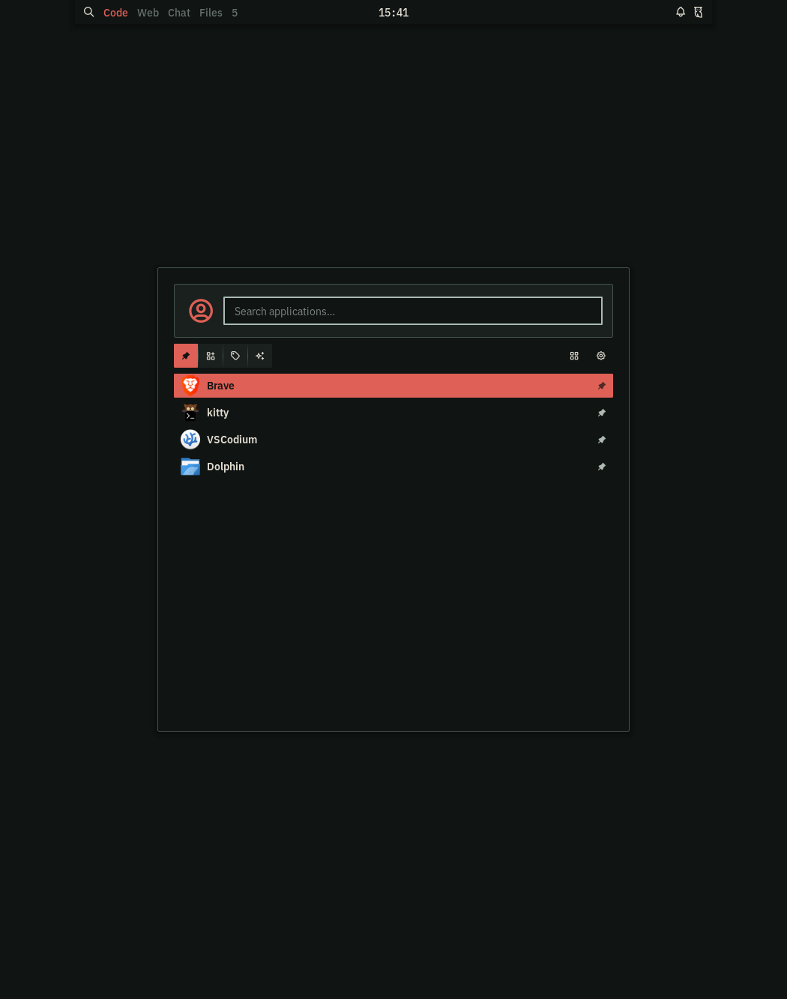

# SIGNALIS Penrose

**English** · [Русский](README.ru.md)

An unofficial SIGNALIS-inspired desktop theme for Niri and Noctalia. Penrose pairs a dark green palette with red focus accents, a compact top bar, and four named workspaces.



## Requirements

The original setup ran on CachyOS with Niri 26.04 and Noctalia 5.5. The public profiles were checked with Niri 26.04 and Noctalia 5.6.0. Install IBM Plex Sans and IBM Plex Mono for the preview typography. Kitty, Brave, Dolphin, and VSCodium are optional. Edit the associated shortcuts and launcher pins if you use other applications.

## Installation

Run the commands from the repository root in Bash. Use `lang=ru` for Russian or `lang=en` for English. These profiles set Noctalia's interface language, including translated launcher and lock screen strings, and Niri's workspace names and shortcut descriptions. The system locale and keyboard layout stay as configured. Strings supplied by external apps and missing upstream translations may use another language.

1. Back up your Niri and Noctalia configuration directories and the Noctalia state directory (`${XDG_STATE_HOME:-$HOME/.local/state}/noctalia`). Keep the backups until you have tested the profile. The four destination files below are reserved for Penrose. Move any existing files at those paths into your backup before proceeding.
2. Copy the configuration files:

   ```bash
   lang=en
   cfg="${XDG_CONFIG_HOME:-$HOME/.config}"
   install -Dm644 noctalia/palettes/Penrose.json "$cfg/noctalia/palettes/Penrose.json"
   install -Dm644 noctalia/penrose.toml "$cfg/noctalia/90-penrose.toml"
   install -Dm644 "noctalia/$lang.toml" "$cfg/noctalia/91-penrose-language.toml"
   install -Dm644 "niri/$lang.kdl" "$cfg/niri/penrose.kdl"
   ```
3. Add `include "penrose.kdl"` once at the top level of `$cfg/niri/config.kdl`. Review overlapping shortcuts first. Keep one definition for each key combination and merge any workspace names you already use.
4. Run `niri validate -c "$cfg/niri/config.kdl"` and `noctalia config validate`. After both pass, use `noctalia msg config-reload` in your session. Log out and back in if the interface language stays cached. Settings saved through Noctalia's UI can override the TOML files. If needed, select Penrose and your language in Settings.
5. Open the launcher with `Mod+Space`, switch workspaces with `Mod+1–4`, and test the lock screen with `Mod+Alt+L`. Choose your own wallpaper from Noctalia's wallpaper picker.

To switch languages, repeat step 2 for the language TOML and Niri fragment, then repeat steps 4–5. The screenshots were taken in clean nested sessions with a neutral background and the device indicators hidden.

### Optional VSCodium theme

Copy `vscodium/` into `~/.vscode-oss/extensions/local.signalis-penrose-1.0.0/`. Restart VSCodium and choose **SIGNALIS — Penrose** in **Preferences: Color Theme**.

### Rollback

Remove the Niri include, remove the four Penrose files, and restore any settings you edited from your backup. If you changed Noctalia settings in the UI, restore the backed-up Noctalia state with Noctalia stopped. Validate both configurations before logging back in. Remove the optional editor extension if installed and reselect your previous theme.

## AI assistance and license

This rice was created primarily with AI assistance. The author estimates that about 3% was written by hand.

The published code and configuration are available under the [MIT License](LICENSE). See [credits](CREDITS.md) for attribution.
