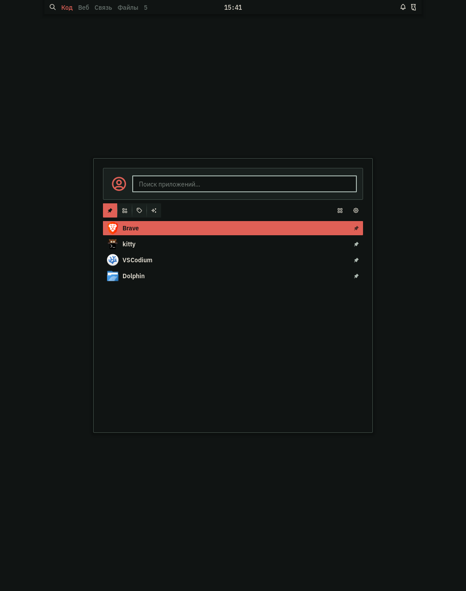

# SIGNALIS Penrose

[English](README.md) · **Русский**

Неофициальное оформление рабочего стола Niri и Noctalia в духе SIGNALIS. В Penrose тёмно-зелёная палитра сочетается с красной рамкой фокуса, компактной верхней панелью и четырьмя именованными рабочими пространствами.



## Требования

Исходный профиль создавался на CachyOS с Niri 26.04 и Noctalia 5.5. Публичные профили проверены с Niri 26.04 и Noctalia 5.6.0. Для шрифтов как на скриншоте установите IBM Plex Sans и IBM Plex Mono. Kitty, Brave, Dolphin и VSCodium необязательны. Если используете другие приложения, измените соответствующие сочетания клавиш и закреплённые приложения в лаунчере.

## Установка

Выполняйте команды из корня репозитория в Bash. Укажите `lang=ru` для русской версии или `lang=en` для английской. Профиль задаёт язык интерфейса Noctalia, включая доступные переводы лаунчера и блокировки, а также названия рабочих пространств и описания клавиш Niri. Системный язык и раскладка остаются прежними. Строки сторонних приложений и строки без перевода в Noctalia могут отображаться на другом языке.

1. Сделайте резервную копию каталогов конфигурации Niri и Noctalia, а также каталога состояния Noctalia (`${XDG_STATE_HOME:-$HOME/.local/state}/noctalia`). Сохраните копии до окончания проверки. Четыре пути ниже предназначены для Penrose. Если на этих путях уже есть файлы, переместите их в резервную копию.
2. Скопируйте конфигурацию:

   ```bash
   lang=ru
   cfg="${XDG_CONFIG_HOME:-$HOME/.config}"
   install -Dm644 noctalia/palettes/Penrose.json "$cfg/noctalia/palettes/Penrose.json"
   install -Dm644 noctalia/penrose.toml "$cfg/noctalia/90-penrose.toml"
   install -Dm644 "noctalia/$lang.toml" "$cfg/noctalia/91-penrose-language.toml"
   install -Dm644 "niri/$lang.kdl" "$cfg/niri/penrose.kdl"
   ```
3. Один раз добавьте `include "penrose.kdl"` на верхнем уровне файла `$cfg/niri/config.kdl`. Сначала проверьте пересечения клавиш. Для каждой комбинации оставьте одно определение и учтите уже используемые имена рабочих пространств.
4. Выполните `niri validate -c "$cfg/niri/config.kdl"` и `noctalia config validate`. После успешной проверки выполните `noctalia msg config-reload`. Если язык интерфейса не обновился, выйдите из сессии и войдите снова. Параметры, сохранённые через интерфейс Noctalia, могут перекрывать TOML. При необходимости выберите Penrose и нужный язык в настройках.
5. Откройте лаунчер через `Mod+Space`, переключите рабочие пространства через `Mod+1–4` и проверьте блокировку через `Mod+Alt+L`. Свои обои можно выбрать в меню обоев Noctalia.

Для смены языка повторите шаг 2 для файла языка TOML и фрагмента Niri, затем шаги 4–5. Скриншоты сделаны во вложенных чистых сессиях с нейтральным фоном и скрытыми индикаторами устройства.

### Тема VSCodium

Скопируйте `vscodium/` в `~/.vscode-oss/extensions/local.signalis-penrose-1.0.0/`. Перезапустите VSCodium и выберите **SIGNALIS — Penrose** через **Preferences: Color Theme**.

### Откат

Удалите строку подключения в Niri и четыре файла Penrose. Восстановите из копии параметры, которые меняли вручную. Если меняли параметры через интерфейс Noctalia, остановите Noctalia и восстановите её каталог состояния. Проверьте оба конфига перед повторным входом. Если ставили тему редактора, удалите расширение и выберите прежнюю тему.

## Участие ИИ и лицензия

Этот rice создан преимущественно с помощью ИИ. Вручную было написано примерно 3%.

Опубликованные код и конфигурация доступны под [лицензией MIT](LICENSE). Сведения об исходных проектах собраны в [CREDITS.md](CREDITS.md).
